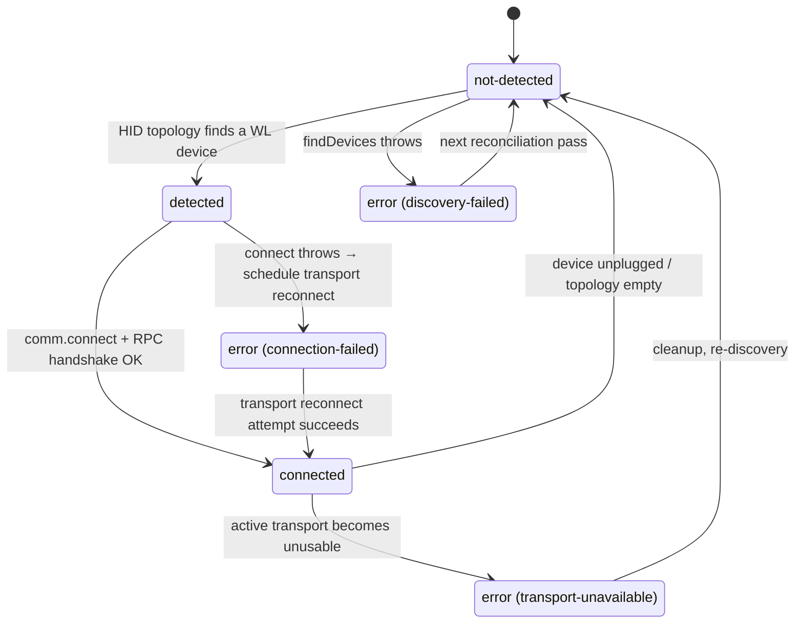
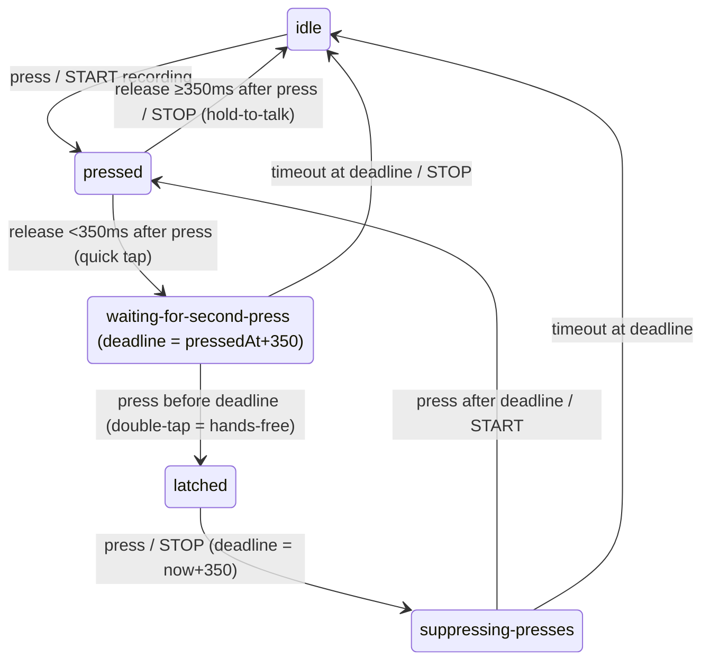
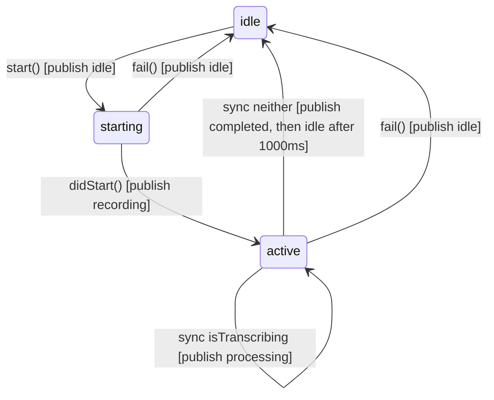

# Codex Micro — State Machines in the ChatGPT Desktop App

*Reverse-engineered 2026-08-08 from the installed ChatGPT desktop app
(`OpenAI.Codex` v26.803.5235.0). Sources: renderer chunks
`codex-micro-bridge`, `codex-micro-slot-signals`, `codex-micro-mini-games`,
`codex-micro-onboarding-animation`, `codex-micro-settings`; main-process
bundle `main-9TSQ_KaE.js`; device service bundle `service-CJETEjOt.js`.
All timing constants are literal values from the code.*

The integration is split across three layers, each owning distinct machines:

```
┌────────────────────────────────────────────────────────────────────┐
│ Device service (utility process, service-*.js)                     │
│   • Device connection state machine (discovery/connect/reconnect)  │
│   • Lighting model push, battery polling, AG-key slot resolution   │
├────────────────────────────────────────────────────────────────────┤
│ Main process (ServiceManager, main-*.js)                           │
│   • Lifecycle transition derivation (connected/lost/reconnected)   │
│   • Agent-key tap machine (double-tap, window focus/open)          │
│   • Window ownership (only one window drives the device)           │
├────────────────────────────────────────────────────────────────────┤
│ Renderer (CodexMicroBridge, webview chunks)                        │
│   • Slot status machine (6 agent keys ← thread state)              │
│   • Push-to-talk key machine        • Voice lighting machine       │
│   • Encoder (knob) machine          • Joystick + mini-game gesture │
│   • Lighting override precedence                                   │
└────────────────────────────────────────────────────────────────────┘
```

---

## 1. Device connection state machine (device service)

State shape (atom default):

```ts
{ status: "not-detected", transport: null, model: null, error: null, battery: null }
```

- `status`: `not-detected | detected | connected | error`
- `transport`: `usb | bluetooth | unknown | null`
- `error` (only when `status === "error"`):
  `discovery-failed | connection-failed | transport-unavailable`
- `battery`: `{ percentage }` or `null` (refreshed via `getDeviceStatus` RPC
  after connect and periodically; RPC failure invalidates the connection
  with reason `battery-rpc`)



Mechanics worth knowing:

- Every `setDeviceState` call carries a **cause**: `device-lifecycle`
  (normal), `service-stop`, or `transport-handoff`. The cause travels with
  the state to the main process and controls lifecycle derivation (§2).
- **Transport handoff**: when a device switches USB↔Bluetooth, the service
  briefly reports `not-detected` with cause `transport-handoff` so the
  upper layers don't treat the gap as a real disconnect.
- A native `hid-topology-watcher` module fires topology-changed events;
  the service runs a "topology settle retry" (debounced reconciliation)
  rather than reacting to every USB enumeration blip.
- The service itself has a tiny lifecycle: `stopped | started` +
  `connectionAttemptId` guards so stale async connect attempts that lose
  the race are discarded (`isCurrentConnectionAttempt`).
- `transportReconnectAttempt` counts retries after `connection-failed`;
  reset to 0 on successful connect or when no device is present.

## 2. Lifecycle transition derivation (main process)

`ServiceManager.getLifecycleEvent(prev, next, cause)` converts raw state
changes into **user-facing transitions** (these drive the onboarding/HUD
animation and analytics). It keeps three flags:
`connectionFailureLogged`, `reconnectPending`, `transportHandoffSource`.

| prev → next (cause `device-lifecycle`) | Emitted transition |
|---|---|
| anything-but-connected → `connected`, `reconnectPending` unset | `connected` |
| anything-but-connected → `connected`, `reconnectPending` set | `reconnected` |
| `connected` → `error` or `not-detected` | `connection-lost` (sets `reconnectPending`) |
| `detected` → `error` (first time only, gated by `connectionFailureLogged`) | `connection-failed` |
| `error` → `not-detected` after a logged failure | *(suppressed)* |
| handoff pending and next is `error`/`not-detected` | `connection-lost` with the pre-handoff transport |

- Cause `service-stop` → reset all flags, emit nothing.
- Cause `transport-handoff` → record `transportHandoffSource` (old
  transport) on `connected → not-detected`; clear it when connected again;
  emit nothing.
- A separate `first-detected` transition is emitted by the renderer when
  the device is seen and a persisted `codex-micro-has-ever-been-detected`
  flag is still false.
- The full transition vocabulary (also mirrored in analytics protobufs):
  `first-detected, connected, reconnected, connection-lost,
  connection-failed`.

The transition is broadcast to the renderer as the
`codex-micro-device-lifecycle` event `{state, transition, transport}`.

## 3. Agent-key slot status machine (renderer, slot-signals)

Each of the six slots `AG00`–`AG05` carries:

```ts
{ id: 0–5, threadKey, title, selected: boolean, pulsing: boolean,
  status: "off" | "idle" | "unread" | "working"
        | "awaiting-approval" | "awaiting-response" | "error" }
```

Status derivation per assigned thread (function `X` in slot-signals):

```
LOCAL thread (running in this app):
    status === "error"            → error
    pendingChip === "approval"    → awaiting-approval
    pendingChip === "response"    → awaiting-response
    status === "loading"          → working
    unread                        → unread
    otherwise                     → idle

REMOTE thread (cloud task):
    latestTurnStatus === "failed"                 → error
    latestTurnStatus === "pending"|"in_progress"  → working
    has_unread_turn                               → unread
    otherwise                                     → idle

No thread assigned → off
```

Suppression rule: if the slot's thread is **selected** and the app window
is **focused**, an `unread` status is displayed as `idle` (you're already
looking at it).

Slot→thread assignment depends on the agent source setting
(`pinned | recent | priority | custom`):

- `pinned`: first 6 of pinned chats + pinned project groups, in pin order.
- `recent`: 6 most recently updated threads (pinned + unpinned merged,
  sorted by update time).
- `priority`: 6 threads ranked by attention state + recency.
- `custom`: explicit per-key assignment map, persisted as
  `codex-micro-custom-agent-assignments` with keys `AG00…AG05`. A custom
  entry is either a thread (`{hostId, threadKey, title}`) or an action
  (`command | skill | keycap`); action entries render `idle` with the
  command/skill name as title. Assigning a thread that is already on
  another key clears the old key (a thread can occupy only one slot).
  Assignment flow has a small pending state: press an empty key →
  `{agentKeyId, clientThreadId}` pending marker → resolved to a full
  assignment once the conversation id exists.

The full serialized device payload (diffed with `JSON.stringify` before
each push, so the device only receives real changes):

```ts
{ brightness: 0–1, inactivityTimeoutMs, preserveSelectionLighting?,
  snakingAmbientStatus, suspendDeviceStatusRefresh?, voiceState,
  slots: [{id, threadKey, title, status, selected, pulsing}] }
```

## 4. Agent-key tap machine (main process)

The device service resolves `AG0([0-5])` to `slot` and attaches the
`threadKey` from its currently displayed lighting model before forwarding
the event upward. Main's `ServiceManager` then decides window behavior
with `lastAgentTap: {owner, slot, threadKey, pressedAt} | null` and a
**350 ms** double-tap window (`Fce = 350`):

```
on HID press (act===1, slot!=null):
  session locked → drop event, lastAgentTap = null
  n = threadKey for slot, r = slot has a custom ACTION assignment
  activate = (!r AND lastAgentTap matches same window/slot/threadKey
                 AND 0 ≤ now−pressedAt ≤ 350)          # double tap
             OR (singleTapAgentKeys setting AND !r)     # opt-in single tap
  lastAgentTap = (activate or r) ? null : this tap      # first tap arms
  window closed:
      activate or r → ensure window, send event with threadKey,
                      showWindow(stealFocus)
      else          → swallow (first tap on a closed window does nothing)
  window open:
      always forward event to renderer (renderer selects/navigates)
      activate → additionally showWindow(stealFocus)
```

So: **first tap** switches the in-app selection to that thread (and lights
the key as selected); **second tap within 350 ms** raises and focuses the
ChatGPT window. The `singleTapAgentKeys` setting ("Focus Codex with a
single tap") collapses both into one tap. Custom action keys (`r`) fire on
every press and never arm the double-tap tracker.

Related: main also tracks **window ownership** — only the primary window
drives lighting/HID (`codex-micro-window-ownership-changed {isOwner}`);
on owner change the old renderer tears down all its Micro state.
`AG00` doubles as **Escape**: with a menu/listbox open in the composer,
any agent key is swallowed and `AG00` dispatches Escape (see §8).

## 5. Push-to-talk key machine (renderer)

Applies in dictation mode (`voiceButtonMode !== "realtime"`). Driven by
`push-to-talk-press/-release` HID events plus scheduled timeouts; window
constant **350 ms** (`Ot`). Actions dispatch host messages
`codex-micro-push-to-talk-start/-stop`, consumed by the composer's
dictation controller (stop → transcript is inserted into the composer).



Semantics: **hold** = record while held; **quick tap** = keep recording,
wait 350 ms — a **second tap latches** hands-free recording; while latched,
one press stops, and the 350 ms `suppressing-presses` window swallows the
bounce so the stopping press can't immediately restart. Changing voice
mode or losing device/ownership force-resets to `idle` (dispatching STOP if
recording was active).

### Realtime variant (Voice Chat mode)

When `voiceButtonMode === "realtime"`, the same key uses a simpler
press/release → short/long classifier with a **500 ms** hold threshold:

- `short-press` → `realtimeVoice.toggleMicrophoneMute` (fallback:
  `composer.startVoiceMode` if no call is active)
- `long-press` (≥500 ms) → `realtimeVoice.endCall`

## 6. Voice lighting machine (renderer → device `voiceState`)

Class with internal `phase` and published `voiceState` (what the device
LEDs show); completion linger **1000 ms** (`qis`):

```
phase: idle → starting → active → idle
published voiceState: idle | recording | processing | completed
```



During a mini-game the device payload pins `voiceState: "idle"`.

## 7. Encoder (knob) machine (renderer)

HID encoding: `ENC_CW` / `ENC_CC` with `act === 2` are rotation ticks
(mapped to virtual `ArrowUp` / `ArrowDown`); any other `ENC*` key gives
`encoder-press` (`act 1`) / `encoder-release` (`act 0`).

Press handling (hold threshold **500 ms**, `wn`):

- press → start timer. Timer fires → **long-press**: custom mode runs the
  `longPress` mapping; otherwise navigates to `/settings/codex-micro`.
  A flag suppresses the following release.
- release before 500 ms → **click**, dispatched by `encoderMode`:
  - `custom` → the `click` mapping (command or skill)
  - `conversation-scroll` → jump to bottom of the conversation
  - `reasoning` → activate the reasoning control: focuses/enters the
    reasoning slider inside the model-picker menu, with special-case
    handling when the menu is already open
  - fallback: activate the highlighted composer-navigation target, an open
    menu item, or dispatch `Enter`

Rotation, by `encoderMode`:

- `custom` → `left` / `right` mappings
- `reasoning` → `composer.decreaseReasoningEffort` on CW-tick-mapped
  `ArrowUp`, `increase` on `ArrowDown`; requires the reasoning target to
  exist; an open reasoning menu is auto-dismissed with Escape after
  **1500 ms** of inactivity (`Cn`)
- `conversation-scroll` → scroll timeline ±**160 px** per tick (`xn`),
  also handles the full-width review panel by finding its scrollable
- fallback: navigate open menus / approval surfaces, else move
  composer-navigation highlight next/previous

Each rotation tick also sets a "knob pulse" UI state cleared after
**180 ms** of no ticks. Composer-navigation highlights auto-clear after
**2000 ms** (`Pt`).

## 8. Composer navigation + AG00-as-Escape lighting

The knob's navigation mode drives a DOM-walking selector
(`[data-composer-navigation-target]` elements) with interaction state
`null | selected | open` (tracked via MutationObservers on
`aria-expanded`/`data-state`). That interaction state feeds back into
**device lighting**: while a navigation surface is `open`, the slot array
is replaced by `jt()` — slot 0 (**AG00**) lights `error`-red as a visual
"Escape" hint, all other slots `off`, and the ambient ring snakes in
`unread` color (vs `working` while merely `selected`). Correspondingly,
with an open menu/listbox, agent-key presses are swallowed and `AG00`
dispatches Escape.

## 9. Joystick machine + mini-game gesture (renderer)

Joystick events are polar: `{angle: 0–1, distance: 0–1}`.

**Direction actions**: a helper derives the active 4-way direction
(deadzone-based); an action fires on direction **change** (enter, not
repeat). If a composer is open, execution is deferred **220 ms** (`Sn`) —
giving the spin-gesture recognizer a chance to win — then runs and reports
`triggered | unavailable` to the joystick HUD, which auto-hides after
**600 ms**.

**Mini-game spin recognizer** (`codex-micro-mini-games`, function `m`):

State: `{accumulatedTurns, direction, lastAngle, lastAt, startedAt}`.

Constants: min `distance` **0.2**; angle deltas wrap at ±0.5 turns;
same-direction accumulation; reversal ≥ **0.02** turns resets; gap
> **1000 ms** between samples resets; total window **6000 ms**;
`captured` (suppresses normal direction actions) at **0.04** turns;
**activates at 1.9 accumulated turns** — i.e. spin the stick almost two
full circles within 6 seconds.

On activation: a random game of `brick-breaker | asteroids | snake`
launches in the composer area. While a game is open:

- HID events route to the game (`AG00` press = action button; in
  asteroids slot 0 lights `working` as the fire key, all others `off`)
- device ambient snakes in `error` (red), `suspendDeviceStatusRefresh`
  is set and `voiceState` pinned to `idle`
- a **re-arm** flag requires the stick to return to `distance ≤ 0.1`
  before joystick input is honored again (prevents the launch spin from
  feeding the game / re-triggering)

## 10. Lighting override precedence (renderer → device)

The single `watch` that computes the device payload applies overrides in
this order (first match wins):

1. **Onboarding animation** playing → demo slot loop (a scripted 12 s
   cycle through statuses across the six keys and command keycaps)
2. **Mini-game** open → game lighting (§9)
3. **Composer navigation** interaction state `open`/`selected` → AG00
   escape hint / ambient snake (§8)
4. Normal **slot signals** (§3)

Payloads are deduplicated by serialized comparison and pushed one at a
time (`updateLighting`), with a queued-latest strategy — if a push is in
flight, only the newest pending payload is sent next.

## 11. Onboarding flow (settings/first-run)

Screens: `welcome → agent-keys → command-keys`. Step events:
`screen-shown, screen-continued, flow-completed, flow-dismissed,
settings-opened, input-monitoring-settings-opened,
input-monitoring-permission-granted`.

macOS Input Monitoring permission state:
`granted | denied | unavailable | not-applicable` (non-macOS is
`not-applicable`).

Persisted device memory keys:
`codex-micro-has-ever-been-detected`,
`codex-micro-last-detected-device-model` (drives the `first-detected`
transition and model-specific UI, e.g. Creator Micro vs Codex Micro).

## 12. Event / IPC channel reference

| Channel (main → renderer) | Payload |
|---|---|
| `codex-micro-device-state-changed` | `{cause, state}` — state per §1 |
| `codex-micro-device-lifecycle` | `{state, transition, transport}` — §2 |
| `codex-micro-window-ownership-changed` | `{isOwner}` |
| `codex-micro-hid-event` | `{key, act, agent, slot, threadKey}` — `act`: 1 press, 0 release, 2 rotate |
| `codex-micro-joystick-event` | `{angle, distance}` |

| Host message (renderer → composer/main) | Purpose |
|---|---|
| `codex-micro-push-to-talk-start` / `-stop` | Dictation control (§5) |
| `codex-micro-insert-composer-text` | Composer-text keycap |
| `codex-micro-insert-skill-mention` | Skill keycap/joystick action |

| Renderer → main RPC | Purpose |
|---|---|
| `getState()` / `ownsPrimaryWindow()` | Initial sync |
| `updateAgentThreadKeys(threadKeys, actionSlots, singleTap)` | Slot→thread map for the tap machine (§4) |
| `updateLighting(payload)` | Push §3/§10 payload to device |

## Timing constants summary

| Constant | Value | Used for |
|---|---|---|
| Double-tap window (agent keys, main) | 350 ms | §4 |
| Push-to-talk tap/latch window | 350 ms | §5 |
| Realtime voice long-press | 500 ms | §5 |
| Encoder long-press | 500 ms | §7 |
| Knob pulse clear | 180 ms | §7 |
| Reasoning menu auto-escape | 1500 ms | §7 |
| Composer highlight auto-clear | 2000 ms | §8 |
| Joystick deferred execution | 220 ms | §9 |
| Joystick HUD hide | 600 ms | §9 |
| Mini-game spin: activate / capture | 1.9 / 0.04 turns | §9 |
| Mini-game spin: sample gap / total window | 1000 / 6000 ms | §9 |
| Mini-game re-arm distance | ≤ 0.1 | §9 |
| Voice `completed` linger | 1000 ms | §6 |
| Conversation scroll per knob tick | 160 px | §7 |
| Onboarding demo cycle | 12 000 ms | §10 |
